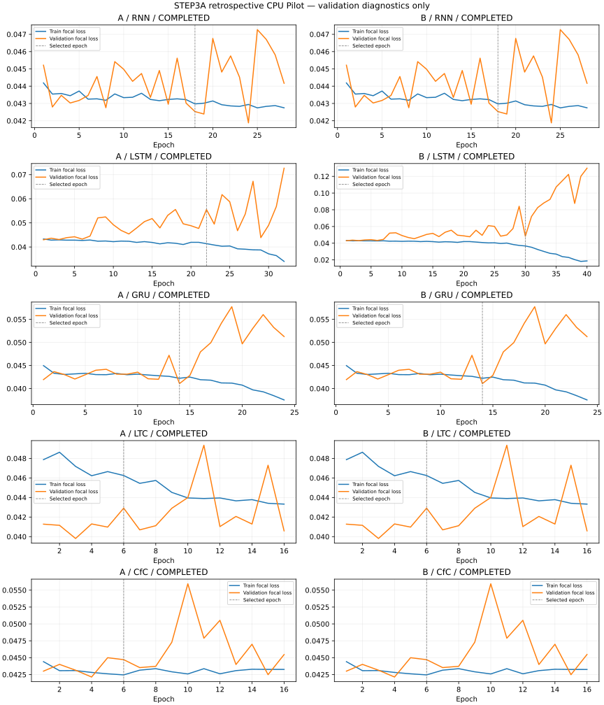
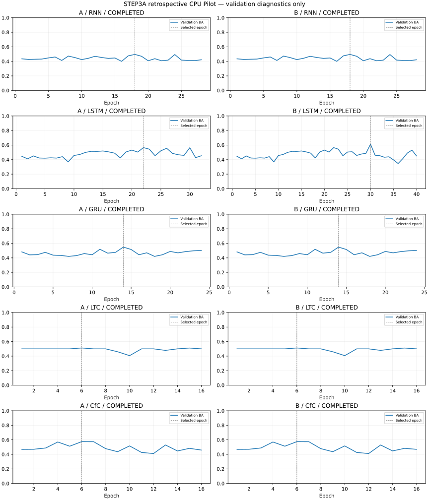

# STEP3A 제한적 실자료 CPU Pilot 결과

확인일: 2026-11-16 (Asia/Seoul). 이번 단계는 과거 자료의 Train/Validation 학습이 정상적으로 동작하는지 확인하는 **회고적·탐색적 구현 Pilot**이다. 아래 숫자는 EarlyStopping에 사용한 Validation 진단이며, 독립 Test 평가·논문 일반화 성능·실시간 예측·투자 수익성·미래정보 누출 완전 배제를 입증하지 않는다.

실제 시작한 fit 10/최대10, 완료 10, 실패/발산 0다. A/B 각각 다섯 아키텍처를 독립적으로 학습했고 추가 모델이나 seed를 시도하지 않았다. Train2387개·Validation228개, 원본 구조·F1입력순서·고정 offset·max100epoch·patience10·CPU/FP32/AMP-off를 유지했다.

| 후보 | 모델 | 실행epoch | 최적epoch | Val BA | MacroF1 | Recall0 | Recall1 | Accuracy | Brier | 양성예측률 | 예측상태 |
|---|---|---|---|---|---|---|---|---|---|---|---|
| A | RNN | 28 | 18 | 0.495570 | 0.488390 | 0.200000 | 0.791139 | 0.609649 | 0.244863 | 0.793860 | TWO_CLASS_PREDICTION |
| A | LSTM | 32 | 22 | 0.565009 | 0.539062 | 0.585714 | 0.544304 | 0.557018 | 0.266318 | 0.504386 | TWO_CLASS_PREDICTION |
| A | GRU | 24 | 14 | 0.547920 | 0.547619 | 0.285714 | 0.810127 | 0.649123 | 0.236807 | 0.780702 | TWO_CLASS_PREDICTION |
| A | LTC | 16 | 6 | 0.511935 | 0.485714 | 0.542857 | 0.481013 | 0.500000 | 0.248523 | 0.473684 | TWO_CLASS_PREDICTION |
| A | CfC | 16 | 6 | 0.575045 | 0.573718 | 0.428571 | 0.721519 | 0.631579 | 0.245925 | 0.675439 | TWO_CLASS_PREDICTION |
| B | RNN | 28 | 18 | 0.495570 | 0.488390 | 0.200000 | 0.791139 | 0.609649 | 0.244863 | 0.793860 | TWO_CLASS_PREDICTION |
| B | LSTM | 40 | 30 | 0.611664 | 0.596376 | 0.571429 | 0.651899 | 0.627193 | 0.242451 | 0.583333 | TWO_CLASS_PREDICTION |
| B | GRU | 24 | 14 | 0.547920 | 0.547619 | 0.285714 | 0.810127 | 0.649123 | 0.236807 | 0.780702 | TWO_CLASS_PREDICTION |
| B | LTC | 16 | 6 | 0.511935 | 0.485714 | 0.542857 | 0.481013 | 0.500000 | 0.248523 | 0.473684 | TWO_CLASS_PREDICTION |
| B | CfC | 16 | 6 | 0.575045 | 0.573718 | 0.428571 | 0.721519 | 0.631579 | 0.245925 | 0.675439 | TWO_CLASS_PREDICTION |

최적 epoch는 Validation BA가 엄격히 개선된 최초 epoch다. 동점은 개선으로 보지 않고 patience를 증가시켰다. Accuracy/F1/Recall/Brier 또는 후보간 성능으로 checkpoint를 선택하지 않았다. 최적 checkpoint를 다시 로드한 Validation 결과가 해당 epoch 기록과 정확히 같음을 검사했다.

최적 checkpoint의 단일 클래스 예측 모델: 없음. 실패/발산: 없음. 단일 클래스 예측은 DEGENERATE_PREDICTION으로 표시했고, 학습 완료 여부와 구분했다. 모든 epoch의 단일 클래스 여부도 history에 남겼다. NaN/발산/예외를 숨기거나 모델을 다시 초기화해 좋은 결과로 교체하지 않았다.

곡선의 점선은 BA 기준 최적 epoch이며 실증 성능 우열을 주장하기 위한 그림이 아니다. 전체 epoch의 Train/Validation focal loss, BA 및 진단지표, learning rate, optimizer step, patience 상태는 manifests/step3a_epoch_history.csv에 보존했다. 모델별 checkpoint·학습 history·Validation 일별 확률은 새 ignored 디렉터리에만 저장했다. 공개 manifest에는 집계와 해시만 있다.

원본 Notebook의 모델·FocalLoss 정의는 실제 셀6/8의 소스 해시를 검증해 그대로 재사용했다. alpha0.25는 원본처럼 focal loss 전체 배율이며 클래스별 alpha_t 보정이 아니다. OneCycleLR은 steps_per_epoch38·최대100epoch로 구성하고 실제 EarlyStopping까지의 step만 수행했다. threshold는 확률>0.5다.

## 학습 중 단일 클래스 예측

- A / LTC: 11/16개 epoch에서 DEGENERATE_PREDICTION. 선택된 최적 checkpoint는 두 클래스 예측.
- B / LTC: 11/16개 epoch에서 DEGENERATE_PREDICTION. 선택된 최적 checkpoint는 두 클래스 예측.

이 현상은 학습 실패·손실 발산과 구분한 진단이며, 좋은 epoch만 남기거나 해당 모델을 재학습해 기록을 교체하지 않았다.
