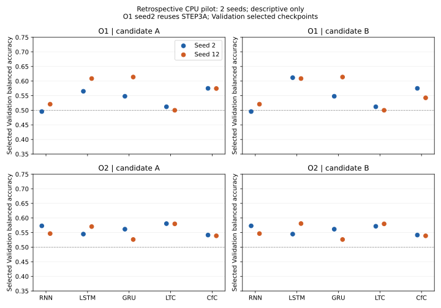

# STEP 3B 실행 결과

확인시각(KST): 2026-11-16T18:13:32.604301+09:00

회고적·탐색적 CPU Train/Validation 구현 진단이다. Validation은 조기 종료와 checkpoint 선택에 사용됐으므로 독립 일반화 성능이 아니다. A/B는 BOTH_UNVERIFIED, production-PIT는 BLOCKED이며 가격·모델·Seed를 선택하지 않았다. 독립 Test 평가, HMM fit, GPU, 전체 5Origin×10Seed, Ablation은 실행하지 않았다. production training_enabled=false, hmm_fit_enabled=false를 유지한다.

## 실행 수와 기존 결과 구분

기존 STEP3A 10개를 재학습 없이 재사용하고, 승인된 신규 30개 중 30개 완료, 0개 실패, 0개 BLOCKED, 0개 미완료로 기록했다. 전체 40개 identity는 가격2×Origin2×Seed2×모델5이며 중복 identity는 없다. STEP3A_REUSED는 O1/Seed2의 A/B 5개 모델이고 STEP3B_NEW는 O1/Seed12 및 O2/Seed2·12이다. 실패/불안정 사례도 대체 Seed 없이 유지한다.

## 표본 및 정보 경계

| Origin | 후보 | Train 시작 | Train 종료 | Train n | Train 0/1 | Validation 시작 | Validation 종료 | Val n | Val 0/1 | Train purge | Val UNKNOWN |
| --- | --- | --- | --- | --- | --- | --- | --- | --- | --- | --- | --- |
| O1 | A | 2010-03-30 | 2019-11-29 | 2387 | 1071/1316 | 2020-01-02 | 2020-12-01 | 228 | 70/158 | 20 | 20 |
| O1 | B | 2010-03-30 | 2019-11-29 | 2387 | 1071/1316 | 2020-01-02 | 2020-12-01 | 228 | 70/158 | 20 | 20 |
| O2 | A | 2010-03-30 | 2020-12-01 | 2635 | 1145/1490 | 2021-01-04 | 2021-12-02 | 228 | 131/97 | 20 | 20 |
| O2 | B | 2010-03-30 | 2020-12-01 | 2635 | 1145/1490 | 2021-01-04 | 2021-12-02 | 228 | 131/97 | 20 | 20 |

공식 KRX 전체 세션 3,939개는 달력 검증용이다. 학습은 O1의 2020년 말까지 2,714개 가격, O2의 2021년 말까지 2,962개 가격 prefix만 읽는다. O2의 2021년은 이번 승인에서 Validation이며 O1 worker는 이 구간에 접근하지 않는다. 각 Origin의 독립 Test는 사용하지 않는다. 마지막 20개 미확정 Validation 타깃은 제외한다. Train label_end는 다음 Validation 시작 이전이고, Validation label_end는 해당 연말까지다. 입력 t-19~t, Close[t+20]>Close[t], 정확한 session_id 차이 20을 유지했다. 2026년 가격/레이블 사용은 0건이다.

## 기존 완료 10개: 변경 및 재학습 없음

| source_stage | origin | seed | candidate | model | status | epochs | best_epoch | validation_BA | macro_f1 | recall0 | recall1 | accuracy | brier | prediction_positive_rate | degenerate_epoch_ratio |
| --- | --- | --- | --- | --- | --- | --- | --- | --- | --- | --- | --- | --- | --- | --- | --- |
| STEP3A_REUSED | O1 | 2 | A | RNN | COMPLETED | 28 | 18 | 0.495570 | 0.488390 | 0.200000 | 0.791139 | 0.609649 | 0.244863 | 0.793860 | 0.000000 |
| STEP3A_REUSED | O1 | 2 | A | LSTM | COMPLETED | 32 | 22 | 0.565009 | 0.539062 | 0.585714 | 0.544304 | 0.557018 | 0.266318 | 0.504386 | 0.000000 |
| STEP3A_REUSED | O1 | 2 | A | GRU | COMPLETED | 24 | 14 | 0.547920 | 0.547619 | 0.285714 | 0.810127 | 0.649123 | 0.236807 | 0.780702 | 0.000000 |
| STEP3A_REUSED | O1 | 2 | A | LTC | COMPLETED | 16 | 6 | 0.511935 | 0.485714 | 0.542857 | 0.481013 | 0.500000 | 0.248523 | 0.473684 | 0.687500 |
| STEP3A_REUSED | O1 | 2 | A | CfC | COMPLETED | 16 | 6 | 0.575045 | 0.573718 | 0.428571 | 0.721519 | 0.631579 | 0.245925 | 0.675439 | 0.000000 |
| STEP3A_REUSED | O1 | 2 | B | RNN | COMPLETED | 28 | 18 | 0.495570 | 0.488390 | 0.200000 | 0.791139 | 0.609649 | 0.244863 | 0.793860 | 0.000000 |
| STEP3A_REUSED | O1 | 2 | B | LSTM | COMPLETED | 40 | 30 | 0.611664 | 0.596376 | 0.571429 | 0.651899 | 0.627193 | 0.242451 | 0.583333 | 0.000000 |
| STEP3A_REUSED | O1 | 2 | B | GRU | COMPLETED | 24 | 14 | 0.547920 | 0.547619 | 0.285714 | 0.810127 | 0.649123 | 0.236807 | 0.780702 | 0.000000 |
| STEP3A_REUSED | O1 | 2 | B | LTC | COMPLETED | 16 | 6 | 0.511935 | 0.485714 | 0.542857 | 0.481013 | 0.500000 | 0.248523 | 0.473684 | 0.687500 |
| STEP3A_REUSED | O1 | 2 | B | CfC | COMPLETED | 16 | 6 | 0.575045 | 0.573718 | 0.428571 | 0.721519 | 0.631579 | 0.245925 | 0.675439 | 0.000000 |

## 신규 실행 30개

| source_stage | origin | seed | candidate | model | status | epochs | best_epoch | validation_BA | macro_f1 | recall0 | recall1 | accuracy | brier | prediction_positive_rate | degenerate_epoch_ratio |
| --- | --- | --- | --- | --- | --- | --- | --- | --- | --- | --- | --- | --- | --- | --- | --- |
| STEP3B_NEW | O1 | 12 | A | RNN | COMPLETED | 22 | 12 | 0.520796 | 0.498611 | 0.142857 | 0.898734 | 0.666667 | 0.240008 | 0.885965 | 0.000000 |
| STEP3B_NEW | O1 | 12 | A | LSTM | COMPLETED | 30 | 20 | 0.608680 | 0.568182 | 0.685714 | 0.531646 | 0.578947 | 0.251879 | 0.464912 | 0.000000 |
| STEP3B_NEW | O1 | 12 | A | GRU | COMPLETED | 28 | 18 | 0.613834 | 0.615922 | 0.442857 | 0.784810 | 0.679825 | 0.236693 | 0.714912 | 0.000000 |
| STEP3B_NEW | O1 | 12 | A | LTC | COMPLETED | 11 | 1 | 0.500000 | 0.409326 | 0.000000 | 1.000000 | 0.692982 | 0.235897 | 1.000000 | 0.818182 |
| STEP3B_NEW | O1 | 12 | A | CfC | COMPLETED | 25 | 15 | 0.574503 | 0.550242 | 0.585714 | 0.563291 | 0.570175 | 0.234200 | 0.517544 | 0.080000 |
| STEP3B_NEW | O1 | 12 | B | RNN | COMPLETED | 22 | 12 | 0.520796 | 0.498611 | 0.142857 | 0.898734 | 0.666667 | 0.240008 | 0.885965 | 0.000000 |
| STEP3B_NEW | O1 | 12 | B | LSTM | COMPLETED | 30 | 20 | 0.608680 | 0.568182 | 0.685714 | 0.531646 | 0.578947 | 0.251794 | 0.464912 | 0.000000 |
| STEP3B_NEW | O1 | 12 | B | GRU | COMPLETED | 28 | 18 | 0.613834 | 0.615922 | 0.442857 | 0.784810 | 0.679825 | 0.236693 | 0.714912 | 0.000000 |
| STEP3B_NEW | O1 | 12 | B | LTC | COMPLETED | 11 | 1 | 0.500000 | 0.409326 | 0.000000 | 1.000000 | 0.692982 | 0.235897 | 1.000000 | 0.818182 |
| STEP3B_NEW | O1 | 12 | B | CfC | COMPLETED | 16 | 6 | 0.542586 | 0.539594 | 0.414286 | 0.670886 | 0.592105 | 0.243572 | 0.644737 | 0.000000 |
| STEP3B_NEW | O2 | 2 | A | RNN | COMPLETED | 16 | 6 | 0.573070 | 0.500325 | 0.259542 | 0.886598 | 0.526316 | 0.250078 | 0.802632 | 0.000000 |
| STEP3B_NEW | O2 | 2 | A | LSTM | COMPLETED | 22 | 12 | 0.544818 | 0.474739 | 0.244275 | 0.845361 | 0.500000 | 0.254178 | 0.793860 | 0.318182 |
| STEP3B_NEW | O2 | 2 | A | GRU | COMPLETED | 17 | 7 | 0.561620 | 0.483078 | 0.236641 | 0.886598 | 0.513158 | 0.250430 | 0.815789 | 0.235294 |
| STEP3B_NEW | O2 | 2 | A | LTC | COMPLETED | 31 | 21 | 0.580664 | 0.565714 | 0.480916 | 0.680412 | 0.565789 | 0.249096 | 0.587719 | 0.645161 |
| STEP3B_NEW | O2 | 2 | A | CfC | COMPLETED | 12 | 2 | 0.541591 | 0.425128 | 0.145038 | 0.938144 | 0.482456 | 0.256826 | 0.890351 | 0.000000 |
| STEP3B_NEW | O2 | 2 | B | RNN | COMPLETED | 16 | 6 | 0.573070 | 0.500325 | 0.259542 | 0.886598 | 0.526316 | 0.250123 | 0.802632 | 0.000000 |
| STEP3B_NEW | O2 | 2 | B | LSTM | COMPLETED | 22 | 12 | 0.544818 | 0.474739 | 0.244275 | 0.845361 | 0.500000 | 0.254179 | 0.793860 | 0.318182 |
| STEP3B_NEW | O2 | 2 | B | GRU | COMPLETED | 17 | 7 | 0.561620 | 0.483078 | 0.236641 | 0.886598 | 0.513158 | 0.250426 | 0.815789 | 0.235294 |
| STEP3B_NEW | O2 | 2 | B | LTC | COMPLETED | 31 | 21 | 0.571693 | 0.556941 | 0.473282 | 0.670103 | 0.557018 | 0.249117 | 0.587719 | 0.645161 |
| STEP3B_NEW | O2 | 2 | B | CfC | COMPLETED | 12 | 2 | 0.541591 | 0.425128 | 0.145038 | 0.938144 | 0.482456 | 0.256868 | 0.890351 | 0.000000 |
| STEP3B_NEW | O2 | 12 | A | RNN | COMPLETED | 25 | 15 | 0.546549 | 0.444696 | 0.175573 | 0.917526 | 0.491228 | 0.248744 | 0.864035 | 0.040000 |
| STEP3B_NEW | O2 | 12 | A | LSTM | COMPLETED | 18 | 8 | 0.570591 | 0.492392 | 0.244275 | 0.896907 | 0.521930 | 0.251298 | 0.815789 | 0.277778 |
| STEP3B_NEW | O2 | 12 | A | GRU | COMPLETED | 11 | 1 | 0.526324 | 0.398026 | 0.114504 | 0.938144 | 0.464912 | 0.251450 | 0.907895 | 0.545455 |
| STEP3B_NEW | O2 | 12 | A | LTC | COMPLETED | 18 | 8 | 0.579917 | 0.548427 | 0.396947 | 0.762887 | 0.552632 | 0.249762 | 0.671053 | 0.833333 |
| STEP3B_NEW | O2 | 12 | A | CfC | COMPLETED | 19 | 9 | 0.538916 | 0.431926 | 0.160305 | 0.917526 | 0.482456 | 0.250847 | 0.872807 | 0.157895 |
| STEP3B_NEW | O2 | 12 | B | RNN | COMPLETED | 25 | 15 | 0.546549 | 0.444696 | 0.175573 | 0.917526 | 0.491228 | 0.248723 | 0.864035 | 0.040000 |
| STEP3B_NEW | O2 | 12 | B | LSTM | COMPLETED | 18 | 8 | 0.580900 | 0.499415 | 0.244275 | 0.917526 | 0.530702 | 0.251287 | 0.824561 | 0.277778 |
| STEP3B_NEW | O2 | 12 | B | GRU | COMPLETED | 11 | 1 | 0.526324 | 0.398026 | 0.114504 | 0.938144 | 0.464912 | 0.251429 | 0.907895 | 0.545455 |
| STEP3B_NEW | O2 | 12 | B | LTC | COMPLETED | 18 | 8 | 0.579917 | 0.548427 | 0.396947 | 0.762887 | 0.552632 | 0.249766 | 0.671053 | 0.833333 |
| STEP3B_NEW | O2 | 12 | B | CfC | COMPLETED | 19 | 9 | 0.538916 | 0.431926 | 0.160305 | 0.917526 | 0.482456 | 0.250795 | 0.872807 | 0.105263 |

COMPLETED는 실행 완료 상태이며 단일 클래스 예측이나 좋은 성능을 의미하지 않는다. 모든 epoch의 손실·학습률·BA·단일 클래스 상태는 [epoch history](../manifests/step3b_epoch_history.csv), 모든 필수 최적 epoch 지표는 [metrics](../manifests/step3b_metrics.csv)에 보존한다. DEGENERATE_PREDICTION은 확률>0.5 예측이 한 클래스인 경우다. 수동 레짐의 실제 정답 클래스가 하나인 경우와 구분한다.

## 가격 표현 민감도

A/B의 Train/Validation 날짜와 모든 레이블은 동일하다. 입력 배열 비교는 아래와 같다. O1 및 O2 Train의 차이는 작은 수치 표현 차이지만, O2 Validation은 2021년 가격 충돌을 포함한다. 최대 차이는 표준화된 피처 공간의 절대차로 원 종가 차이가 아니다.

| origin | partition | float32_elements_different | windows_with_any_difference | maximum_absolute_scaled_feature_difference | labels_different | dates_identical |
| --- | --- | --- | --- | --- | --- | --- |
| O1 | train | 92880 | 2387 | 0.000011593103 | 0 | True |
| O1 | validation | 8802 | 228 | 0.000010848045 | 0 | True |
| O2 | train | 102700 | 2635 | 0.000010490417 | 0 | True |
| O2 | validation | 8861 | 228 | 0.558716133237 | 0 | True |

동일 Origin·Seed·모델에서 B−A Validation BA 차이는 -0.031917~0.046655다. 40개 완료 identity의 수치 민감도이며 원천의 우열이나 주 분석 가격 선택 근거가 아니다. 가격 원천·추출·개정 정책과 당시 18:00 KST 공개시각이 여전히 미확정이다. 가격 차이 및 부동소수점 표현 차이가 피처·학습 경로·최적 epoch에 영향을 줄 수 있으므로 A/B를 독립 후보로 유지한다.

전체 자료: [runs](../manifests/step3b_runs.csv), [execution manifest](../manifests/step3b_execution_manifest.json). 원자료·일별 Target/확률·checkpoint는 ignored 로컬에만 보존한다.
