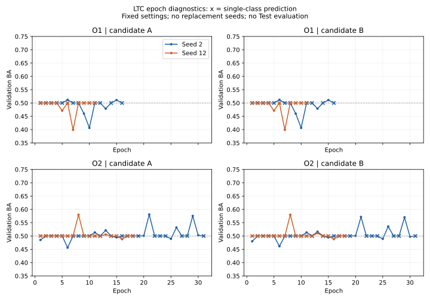

# STEP 3B Seed 안정성 진단

회고적·탐색적 CPU Train/Validation 구현 진단이다. Validation은 조기 종료와 checkpoint 선택에 사용됐으므로 독립 일반화 성능이 아니다. A/B는 BOTH_UNVERIFIED, production-PIT는 BLOCKED이며 가격·모델·Seed를 선택하지 않았다. 독립 Test 평가, HMM fit, GPU, 전체 5Origin×10Seed, Ablation은 실행하지 않았다. production training_enabled=false, hmm_fit_enabled=false를 유지한다.

Seed는 [2,12]이며 아키텍처별 원본 RAW offset RNN101/LSTM201/GRU301/LTC401/CfC501을 그대로 더한다. 원본 모델 구조, FocalLoss 소스 SHA-256 및 하이퍼파라미터는 STEP3A와 같다. 아래 표는 Seed12−Seed2의 짝지은 차이와 두 Seed의 표본 표준편차(ddof=1)다. 두 Seed만으로 최종 안정성·통계적 유의성·우수 모델을 주장할 수 없다. 두 Seed를 연결해 독립 표본 수가 두 배라고 보고하지 않는다. 각 Seed의 Validation은 동일한 228일이다.

| origin | candidate | model | completed_seeds | validation_BA_seed2 | validation_BA_seed12 | validation_BA_mean | validation_BA_std | validation_BA_delta_12_minus_2 | best_epoch_seed2 | best_epoch_seed12 | degenerate_epoch_ratio_seed2 | degenerate_epoch_ratio_seed12 |
| --- | --- | --- | --- | --- | --- | --- | --- | --- | --- | --- | --- | --- |
| O1 | A | RNN | 2 | 0.495570 | 0.520796 | 0.508183 | 0.017838 | 0.025226 | 18.000000 | 12.000000 | 0.000000 | 0.000000 |
| O1 | A | LSTM | 2 | 0.565009 | 0.608680 | 0.586844 | 0.030880 | 0.043671 | 22.000000 | 20.000000 | 0.000000 | 0.000000 |
| O1 | A | GRU | 2 | 0.547920 | 0.613834 | 0.580877 | 0.046608 | 0.065913 | 14.000000 | 18.000000 | 0.000000 | 0.000000 |
| O1 | A | LTC | 2 | 0.511935 | 0.500000 | 0.505967 | 0.008439 | -0.011935 | 6.000000 | 1.000000 | 0.687500 | 0.818182 |
| O1 | A | CfC | 2 | 0.575045 | 0.574503 | 0.574774 | 0.000384 | -0.000542 | 6.000000 | 15.000000 | 0.000000 | 0.080000 |
| O1 | B | RNN | 2 | 0.495570 | 0.520796 | 0.508183 | 0.017838 | 0.025226 | 18.000000 | 12.000000 | 0.000000 | 0.000000 |
| O1 | B | LSTM | 2 | 0.611664 | 0.608680 | 0.610172 | 0.002110 | -0.002984 | 30.000000 | 20.000000 | 0.000000 | 0.000000 |
| O1 | B | GRU | 2 | 0.547920 | 0.613834 | 0.580877 | 0.046608 | 0.065913 | 14.000000 | 18.000000 | 0.000000 | 0.000000 |
| O1 | B | LTC | 2 | 0.511935 | 0.500000 | 0.505967 | 0.008439 | -0.011935 | 6.000000 | 1.000000 | 0.687500 | 0.818182 |
| O1 | B | CfC | 2 | 0.575045 | 0.542586 | 0.558816 | 0.022952 | -0.032459 | 6.000000 | 6.000000 | 0.000000 | 0.000000 |
| O2 | A | RNN | 2 | 0.573070 | 0.546549 | 0.559810 | 0.018753 | -0.026521 | 6.000000 | 15.000000 | 0.000000 | 0.040000 |
| O2 | A | LSTM | 2 | 0.544818 | 0.570591 | 0.557704 | 0.018224 | 0.025773 | 12.000000 | 8.000000 | 0.318182 | 0.277778 |
| O2 | A | GRU | 2 | 0.561620 | 0.526324 | 0.543972 | 0.024958 | -0.035296 | 7.000000 | 1.000000 | 0.235294 | 0.545455 |
| O2 | A | LTC | 2 | 0.580664 | 0.579917 | 0.580290 | 0.000529 | -0.000748 | 21.000000 | 8.000000 | 0.645161 | 0.833333 |
| O2 | A | CfC | 2 | 0.541591 | 0.538916 | 0.540253 | 0.001892 | -0.002676 | 2.000000 | 9.000000 | 0.000000 | 0.157895 |
| O2 | B | RNN | 2 | 0.573070 | 0.546549 | 0.559810 | 0.018753 | -0.026521 | 6.000000 | 15.000000 | 0.000000 | 0.040000 |
| O2 | B | LSTM | 2 | 0.544818 | 0.580900 | 0.562859 | 0.025514 | 0.036082 | 12.000000 | 8.000000 | 0.318182 | 0.277778 |
| O2 | B | GRU | 2 | 0.561620 | 0.526324 | 0.543972 | 0.024958 | -0.035296 | 7.000000 | 1.000000 | 0.235294 | 0.545455 |
| O2 | B | LTC | 2 | 0.571693 | 0.579917 | 0.575805 | 0.005815 | 0.008224 | 21.000000 | 8.000000 | 0.645161 | 0.833333 |
| O2 | B | CfC | 2 | 0.541591 | 0.538916 | 0.540253 | 0.001892 | -0.002676 | 2.000000 | 9.000000 | 0.000000 | 0.105263 |

Macro F1, Accuracy, Recall0/1, Brier, positive rate, best epoch 및 단일 클래스 epoch 비율의 모든 Seed별 값·평균·표준편차·차이는 [전체 CSV](../manifests/step3b_seed_stability.csv)에 있다. 평균으로 실패를 숨기거나 누락 값을 0으로 채우지 않는다. 기존 O1/Seed2의 10개는 재사용했고 O1/Seed12 및 O2 두 Seed는 신규 실행이다.

## LTC 별도 진단

| source_stage | origin | seed | candidate | epochs | best_epoch | validation_BA | prediction_positive_rate | prediction_status | degenerate_prediction_epochs | degenerate_epoch_ratio | stopped_early |
| --- | --- | --- | --- | --- | --- | --- | --- | --- | --- | --- | --- |
| STEP3A_REUSED | O1 | 2 | A | 16 | 6 | 0.511935 | 0.473684 | TWO_CLASS_PREDICTION | 11 | 0.687500 | True |
| STEP3A_REUSED | O1 | 2 | B | 16 | 6 | 0.511935 | 0.473684 | TWO_CLASS_PREDICTION | 11 | 0.687500 | True |
| STEP3B_NEW | O1 | 12 | A | 11 | 1 | 0.500000 | 1.000000 | DEGENERATE_PREDICTION | 9 | 0.818182 | True |
| STEP3B_NEW | O1 | 12 | B | 11 | 1 | 0.500000 | 1.000000 | DEGENERATE_PREDICTION | 9 | 0.818182 | True |
| STEP3B_NEW | O2 | 2 | A | 31 | 21 | 0.580664 | 0.587719 | TWO_CLASS_PREDICTION | 20 | 0.645161 | True |
| STEP3B_NEW | O2 | 2 | B | 31 | 21 | 0.571693 | 0.587719 | TWO_CLASS_PREDICTION | 20 | 0.645161 | True |
| STEP3B_NEW | O2 | 12 | A | 18 | 8 | 0.579917 | 0.671053 | TWO_CLASS_PREDICTION | 15 | 0.833333 | True |
| STEP3B_NEW | O2 | 12 | B | 18 | 8 | 0.579917 | 0.671053 | TWO_CLASS_PREDICTION | 15 | 0.833333 | True |

O1의 Seed12는 A/B 모두 최적 epoch1·종료11epoch이며 최적 예측이 모두1이다. 같은 O1의 기존 Seed2는 최적6·종료16epoch였다. O2에서는 Seed2가 최적21·종료31epoch, Seed12가 최적8·종료18epoch로 바뀌었다. O2 LTC의 단일 클래스 예측 epoch 비율은 Seed2 20/31(64.5%), Seed12 15/18(83.3%)다. 최적 checkpoint의 BA와 별개로 학습 중 단일 클래스 예측이 반복되는 양상을 기록한다. O2 Seed2의 A/B BA는 0.580664/0.571693, Seed12는 두 후보 모두0.579917이다. 두 Seed나 한 검증연도의 수치만으로 안정성을 확정하지 않는다.

LTC의 최적 checkpoint에서 단일 클래스인 identity는 2/8개다. 조기 종료, 단일 클래스 epoch 비율, A/B 민감도를 각각 그대로 기록했다. 수치 발산과 낮은 BA 또는 단일 클래스 예측은 서로 다른 현상이다. 불안정한 Seed를 제외하거나 더 좋은 Seed로 바꾸지 않았다. 전체 LTC 진단은 [CSV](../manifests/step3b_LTC_diagnostics.csv)에 있다.
