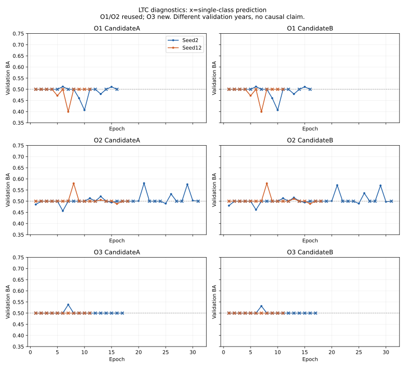

# STEP4A-1 LTC 안정성 진단

사용자 승인 범위의 회고적·탐색적 CPU Train/Validation Pilot이다. A/B는 BOTH_UNVERIFIED이고 production-PIT는 BLOCKED다. 가격·모델·Seed·날짜·설정을 Validation 결과로 선택하지 않았다. 독립 Test2023 및 이후 가격 관측값, HMM fit, GPU, RAW5/외부피처/앙상블, τ 실측 forward, 확증 p값은 사용/실행하지 않았다. 2026년 관측 사용0이다. master production training_enabled=false/hmm_fit_enabled=false/new_fit_execution_enabled=false는 변경하지 않았다.

O1/O2의 기존8개 LTC 결과를 보존하고 O3 신규4개를 비교한다. 아래 모든 종료epoch·최적epoch·BA·단일 클래스 epoch를 빠짐없이 기록했다. 실패가 있다면 성능이 좋은 Seed로 대체하지 않았다.

| source_stage | origin | candidate | seed | status | train_samples | validation_samples | epochs | best_epoch | validation_BA | macro_f1 | prediction_positive_rate | prediction_status | degenerate_prediction_epochs | degenerate_epoch_ratio |
| --- | --- | --- | --- | --- | --- | --- | --- | --- | --- | --- | --- | --- | --- | --- |
| STEP3A_REUSED | O1 | A | 2 | COMPLETED | 2387 | 228 | 16 | 6 | 0.511935 | 0.485714 | 0.473684 | TWO_CLASS_PREDICTION | 11 | 0.687500 |
| STEP3A_REUSED | O1 | B | 2 | COMPLETED | 2387 | 228 | 16 | 6 | 0.511935 | 0.485714 | 0.473684 | TWO_CLASS_PREDICTION | 11 | 0.687500 |
| STEP3B_NEW | O1 | A | 12 | COMPLETED | 2387 | 228 | 11 | 1 | 0.500000 | 0.409326 | 1.000000 | DEGENERATE_PREDICTION | 9 | 0.818182 |
| STEP3B_NEW | O1 | B | 12 | COMPLETED | 2387 | 228 | 11 | 1 | 0.500000 | 0.409326 | 1.000000 | DEGENERATE_PREDICTION | 9 | 0.818182 |
| STEP3B_NEW | O2 | A | 2 | COMPLETED | 2635 | 228 | 31 | 21 | 0.580664 | 0.565714 | 0.587719 | TWO_CLASS_PREDICTION | 20 | 0.645161 |
| STEP3B_NEW | O2 | B | 2 | COMPLETED | 2635 | 228 | 31 | 21 | 0.571693 | 0.556941 | 0.587719 | TWO_CLASS_PREDICTION | 20 | 0.645161 |
| STEP3B_NEW | O2 | A | 12 | COMPLETED | 2635 | 228 | 18 | 8 | 0.579917 | 0.548427 | 0.671053 | TWO_CLASS_PREDICTION | 15 | 0.833333 |
| STEP3B_NEW | O2 | B | 12 | COMPLETED | 2635 | 228 | 18 | 8 | 0.579917 | 0.548427 | 0.671053 | TWO_CLASS_PREDICTION | 15 | 0.833333 |
| STEP4A1_NEW | O3 | A | 2 | COMPLETED | 2883 | 226 | 17 | 7 | 0.538046 | 0.524941 | 0.482301 | TWO_CLASS_PREDICTION | 16 | 0.941176 |
| STEP4A1_NEW | O3 | B | 2 | COMPLETED | 2883 | 226 | 17 | 7 | 0.531552 | 0.519587 | 0.477876 | TWO_CLASS_PREDICTION | 16 | 0.941176 |
| STEP4A1_NEW | O3 | A | 12 | COMPLETED | 2883 | 226 | 11 | 1 | 0.500000 | 0.254125 | 1.000000 | DEGENERATE_PREDICTION | 11 | 1.000000 |
| STEP4A1_NEW | O3 | B | 12 | COMPLETED | 2883 | 226 | 11 | 1 | 0.500000 | 0.254125 | 1.000000 | DEGENERATE_PREDICTION | 11 | 1.000000 |

O3의 Seed2는 A/B 모두17epoch·최적7epoch이며16/17epoch(94.12%)에서 단일 클래스 예측이었다. 최적 BA/MacroF1은 A0.538046/0.524941, B0.531552/0.519587이다. Seed12는 양 후보 모두11epoch·최적1epoch,11/11epoch(100%)에서 모두1을 예측했고 BA0.5/MacroF1 0.254125로 종료했다. O2에서 Seed12의 최적 BA가 약0.58이었던 것과 달라 O3의 안정성을 같은 방식으로 단정할 수 없다. O1/O2/O3의 데이터 기간·클래스 구성 차이도 함께 유지한다.

O3에서 최적 예측이 단일 클래스인 LTC는 2개다. 최적 checkpoint의 두 클래스 예측 여부와 학습 중 단일 클래스 epoch 비율은 별도로 본다. Seed2/12의 최적/종료 시점과 A/B 차이도 위 표에 있다. O1/O2와 O3는 검증연도·학습기간·정답 비율이 달라 인과적 시장 레짐 효과나 일반화 안정성으로 해석하지 않는다.

## O3 두 Seed 요약

| candidate | model | completed_seeds | validation_BA_seed2 | validation_BA_seed12 | validation_BA_mean | validation_BA_std | macro_f1_seed2 | macro_f1_seed12 | best_epoch_seed2 | best_epoch_seed12 | degenerate_epoch_ratio_seed2 | degenerate_epoch_ratio_seed12 |
| --- | --- | --- | --- | --- | --- | --- | --- | --- | --- | --- | --- | --- |
| A | LTC | 2 | 0.538046 | 0.500000 | 0.519023 | 0.026902 | 0.524941 | 0.254125 | 7.000000 | 1.000000 | 0.941176 | 1.000000 |
| B | LTC | 2 | 0.531552 | 0.500000 | 0.515776 | 0.022311 | 0.519587 | 0.254125 | 7.000000 | 1.000000 | 0.941176 | 1.000000 |

표본 표준편차는 ddof1, n2에 한정된다. 다른 Seed·Origin을 제외하거나 사후 추가하지 않는다. NaN/손실 발산은 명시적인 FAILED_DIVERGENCE로 분류하며 단일 클래스 예측 자체와 혼동하지 않는다. 단계별 실패/중단/재개 기록은 실행 감사 및 manifest에 보존한다. 실제 τ forward 추출은 이번에 수행하지 않았다.
