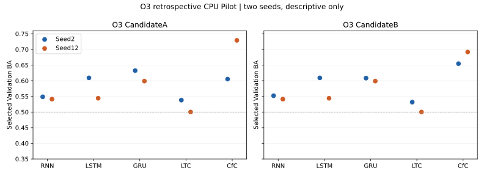

# STEP4A-1 O3 확장 Pilot 결과

확인시각(KST): 2026-11-16T21:25:53.857959+09:00

사용자 승인 범위의 회고적·탐색적 CPU Train/Validation Pilot이다. A/B는 BOTH_UNVERIFIED이고 production-PIT는 BLOCKED다. 가격·모델·Seed·날짜·설정을 Validation 결과로 선택하지 않았다. 독립 Test2023 및 이후 가격 관측값, HMM fit, GPU, RAW5/외부피처/앙상블, τ 실측 forward, 확증 p값은 사용/실행하지 않았다. 2026년 관측 사용0이다. master production training_enabled=false/hmm_fit_enabled=false/new_fit_execution_enabled=false는 변경하지 않았다.

승인된 신규20fit 중 완료20, 실패0, BLOCKED0, 중단미완료0이다. 기존40개는 재학습 없이 보존했으며 실제 전체 완료 수는60개다. 신규 총421epoch/19366optimizer updates를 기록했다. 완료·실패를 다른 Seed로 대체하지 않았다.

## O3 데이터와 지표

Train 경계2010-01-04~2021-12-30, 적격 기준일2010-03-30~2021-12-02, n2883(클래스0/1=1276/1607). Validation 경계2022-01-03~2022-12-29, 적격 기준일2022-01-03~2022-12-01, n226(149/77). 양 후보의 표본 날짜와 레이블은 master와 일치한다. 실제 session_id 기준20세션 endpoint, Train20purge, Validation말단20UNKNOWN 제외를 적용했다. 값에 맞춰 날짜를 조정하지 않았다.

F1=[Log_Ret,Disparity], window t-19~t, 공통 Vol_Regime 적격 마스크 유지. Train scaler는 유지된 입력 날짜 합집합2902행(2010-03-03~2021-12-02)에만 fit했다. Validation은 transform만 했다. 미래 보간/bfill/NaN 자동0 치환은 없다. Vol_Regime은 신경망 입력이 아니다.

| candidate | seed | effective_seed | model | status | epochs | best_epoch | validation_BA | macro_f1 | recall0 | recall1 | accuracy | brier | prediction_positive_rate | degenerate_prediction_epochs | degenerate_epoch_ratio | postfit_checkpoint_audit_status |
| --- | --- | --- | --- | --- | --- | --- | --- | --- | --- | --- | --- | --- | --- | --- | --- | --- |
| A | 2 | 103 | RNN | COMPLETED | 18 | 8 | 0.548636 | 0.499755 | 0.395973 | 0.701299 | 0.500000 | 0.248930 | 0.637168 | 2 | 0.111111 | PASS |
| A | 2 | 203 | LSTM | COMPLETED | 17 | 7 | 0.609126 | 0.513499 | 0.322148 | 0.896104 | 0.517699 | 0.245846 | 0.752212 | 8 | 0.470588 | PASS |
| A | 2 | 303 | GRU | COMPLETED | 39 | 29 | 0.632398 | 0.541654 | 0.355705 | 0.909091 | 0.544248 | 0.346603 | 0.734513 | 7 | 0.179487 | PASS |
| A | 2 | 403 | LTC | COMPLETED | 17 | 7 | 0.538046 | 0.524941 | 0.543624 | 0.532468 | 0.539823 | 0.250536 | 0.482301 | 16 | 0.941176 | PASS |
| A | 2 | 503 | CfC | COMPLETED | 20 | 10 | 0.605116 | 0.490412 | 0.275168 | 0.935065 | 0.500000 | 0.250606 | 0.796460 | 0 | 0.000000 | PASS |
| B | 2 | 103 | RNN | COMPLETED | 18 | 8 | 0.551992 | 0.504075 | 0.402685 | 0.701299 | 0.504425 | 0.248928 | 0.632743 | 2 | 0.111111 | PASS |
| B | 2 | 203 | LSTM | COMPLETED | 17 | 7 | 0.609126 | 0.513499 | 0.322148 | 0.896104 | 0.517699 | 0.245852 | 0.752212 | 8 | 0.470588 | PASS |
| B | 2 | 303 | GRU | COMPLETED | 39 | 29 | 0.608254 | 0.489107 | 0.268456 | 0.948052 | 0.500000 | 0.399744 | 0.805310 | 7 | 0.179487 | PASS |
| B | 2 | 403 | LTC | COMPLETED | 17 | 7 | 0.531552 | 0.519587 | 0.543624 | 0.519481 | 0.535398 | 0.250533 | 0.477876 | 16 | 0.941176 | PASS |
| B | 2 | 503 | CfC | COMPLETED | 41 | 31 | 0.654493 | 0.608658 | 0.516779 | 0.792208 | 0.610619 | 0.256182 | 0.588496 | 5 | 0.121951 | PASS |
| A | 12 | 113 | RNN | COMPLETED | 16 | 6 | 0.541140 | 0.377256 | 0.134228 | 0.948052 | 0.411504 | 0.254227 | 0.893805 | 4 | 0.250000 | PASS |
| A | 12 | 213 | LSTM | COMPLETED | 12 | 2 | 0.544060 | 0.365275 | 0.114094 | 0.974026 | 0.407080 | 0.251277 | 0.915929 | 6 | 0.500000 | PASS |
| A | 12 | 313 | GRU | COMPLETED | 31 | 21 | 0.598841 | 0.492760 | 0.288591 | 0.909091 | 0.500000 | 0.253679 | 0.778761 | 4 | 0.129032 | PASS |
| A | 12 | 413 | LTC | COMPLETED | 11 | 1 | 0.500000 | 0.254125 | 0.000000 | 1.000000 | 0.340708 | 0.262837 | 1.000000 | 11 | 1.000000 | PASS |
| A | 12 | 513 | CfC | COMPLETED | 19 | 9 | 0.729060 | 0.659232 | 0.510067 | 0.948052 | 0.659292 | 0.229751 | 0.646018 | 3 | 0.157895 | PASS |
| B | 12 | 113 | RNN | COMPLETED | 16 | 6 | 0.541140 | 0.377256 | 0.134228 | 0.948052 | 0.411504 | 0.254248 | 0.893805 | 4 | 0.250000 | PASS |
| B | 12 | 213 | LSTM | COMPLETED | 12 | 2 | 0.544060 | 0.365275 | 0.114094 | 0.974026 | 0.407080 | 0.251272 | 0.915929 | 6 | 0.500000 | PASS |
| B | 12 | 313 | GRU | COMPLETED | 31 | 21 | 0.598841 | 0.492760 | 0.288591 | 0.909091 | 0.500000 | 0.254598 | 0.778761 | 4 | 0.129032 | PASS |
| B | 12 | 413 | LTC | COMPLETED | 11 | 1 | 0.500000 | 0.254125 | 0.000000 | 1.000000 | 0.340708 | 0.262842 | 1.000000 | 11 | 1.000000 | PASS |
| B | 12 | 513 | CfC | COMPLETED | 19 | 9 | 0.691711 | 0.600236 | 0.409396 | 0.974026 | 0.601770 | 0.235437 | 0.721239 | 1 | 0.052632 | PASS |

Validation BA만 EarlyStopping/최초 최고 checkpoint 선택에 사용했다. 이 지표는 모델 선택에 쓰인 진단이며 독립 Test 일반화 성능이 아니다. 모든 epoch의 Train/Val loss, BA, MacroF1, Recall0/1, Brier, positive rate, 단일 클래스 상태, running best epoch는 [epoch history](../manifests/step4a1_epoch_history.csv)에 있다. prediction_status가 DEGENERATE_PREDICTION이면 예측이 모두0 또는1이다. 완료 상태를 양호한 학습 상태로 해석하지 않는다.

## A/B 수치 민감도

| seed | model | completed_candidates | validation_BA_A | validation_BA_B | validation_BA_delta_B_minus_A | macro_f1_A | macro_f1_B | best_epoch_A | best_epoch_B | degenerate_epoch_ratio_A | degenerate_epoch_ratio_B |
| --- | --- | --- | --- | --- | --- | --- | --- | --- | --- | --- | --- |
| 2 | RNN | 2 | 0.548636 | 0.551992 | 0.003356 | 0.499755 | 0.504075 | 8.000000 | 8.000000 | 0.111111 | 0.111111 |
| 2 | LSTM | 2 | 0.609126 | 0.609126 | 0.000000 | 0.513499 | 0.513499 | 7.000000 | 7.000000 | 0.470588 | 0.470588 |
| 2 | GRU | 2 | 0.632398 | 0.608254 | -0.024144 | 0.541654 | 0.489107 | 29.000000 | 29.000000 | 0.179487 | 0.179487 |
| 2 | LTC | 2 | 0.538046 | 0.531552 | -0.006494 | 0.524941 | 0.519587 | 7.000000 | 7.000000 | 0.941176 | 0.941176 |
| 2 | CfC | 2 | 0.605116 | 0.654493 | 0.049377 | 0.490412 | 0.608658 | 10.000000 | 31.000000 | 0.000000 | 0.121951 |
| 12 | RNN | 2 | 0.541140 | 0.541140 | 0.000000 | 0.377256 | 0.377256 | 6.000000 | 6.000000 | 0.250000 | 0.250000 |
| 12 | LSTM | 2 | 0.544060 | 0.544060 | 0.000000 | 0.365275 | 0.365275 | 2.000000 | 2.000000 | 0.500000 | 0.500000 |
| 12 | GRU | 2 | 0.598841 | 0.598841 | 0.000000 | 0.492760 | 0.492760 | 21.000000 | 21.000000 | 0.129032 | 0.129032 |
| 12 | LTC | 2 | 0.500000 | 0.500000 | 0.000000 | 0.254125 | 0.254125 | 1.000000 | 1.000000 | 1.000000 | 1.000000 |
| 12 | CfC | 2 | 0.729060 | 0.691711 | -0.037349 | 0.659232 | 0.600236 | 9.000000 | 9.000000 | 0.157895 | 0.052632 |

A/B 입력의 표준화 피처 최대 절대차는 Train 약0.556791, Validation 약0.000319이고 레이블 차이는0이다.2021년 두 가격 충돌이 이제 O3 Train 구간에 포함되며 Train scaler도 각각 계산됐다. 이 값은 원 종가 차이가 아니다. 상세 입력 진단은 step4a1_input_sensitivity.json에 있다.

같은 Seed/모델의 A/B 독립 학습 비교이며 가격 자료의 우열·선택 근거가 아니다. 입력 값/표현 및 Train scaler/레짐 임계값이 후보별로 다를 수 있다. A/B 원천·역사적 공개시각은 계속 미확정이다. 모든 결과를 보존하고 후보·Seed를 고르지 않았다.

## 기존 O1/O2와 O3의 데이터 구성

| Origin | 후보 | source | Train 기간 | Train n | Train 0/1 | Validation 기간 | Val n | Val 0/1 |
| --- | --- | --- | --- | --- | --- | --- | --- | --- |
| O1 | A | STEP3A/3B_REUSED | 2010-03-30~2019-11-29 | 2387 | 1071/1316 | 2020-01-02~2020-12-01 | 228 | 70/158 |
| O1 | B | STEP3A/3B_REUSED | 2010-03-30~2019-11-29 | 2387 | 1071/1316 | 2020-01-02~2020-12-01 | 228 | 70/158 |
| O2 | A | STEP3A/3B_REUSED | 2010-03-30~2020-12-01 | 2635 | 1145/1490 | 2021-01-04~2021-12-02 | 228 | 131/97 |
| O2 | B | STEP3A/3B_REUSED | 2010-03-30~2020-12-01 | 2635 | 1145/1490 | 2021-01-04~2021-12-02 | 228 | 131/97 |
| O3 | A | STEP4A1_NEW | 2010-03-30~2021-12-02 | 2883 | 1276/1607 | 2022-01-03~2022-12-01 | 226 | 149/77 |
| O3 | B | STEP4A1_NEW | 2010-03-30~2021-12-02 | 2883 | 1276/1607 | 2022-01-03~2022-12-01 | 226 | 149/77 |

기존40개는 STEP3A/3B_REUSED, 신규20개는 STEP4A1_NEW로 분리했다. 검증연도2020/2021/2022와 클래스 분포·Train 표본이 함께 다르므로 Origin 차이를 시장의 인과적 레짐 효과라고 단정하지 않는다. [60개 진단표](../manifests/step4a1_all60_diagnostic_metrics.csv)는 기존40개 수치를 변경하지 않고 합쳐 보여준다. 두 Seed의 표준편차는 탐색적 진단이며 확증적 안정성 근거가 아니다.

원자료·일별Target·확률·weights는 ignored local 경로에만 보존한다. [실행 manifest](../manifests/step4a1_execution_manifest.json), [runs](../manifests/step4a1_runs.csv)에 source/config/data/environment/scaler/checkpoint 해시와 고유 identity를 기록했다.
