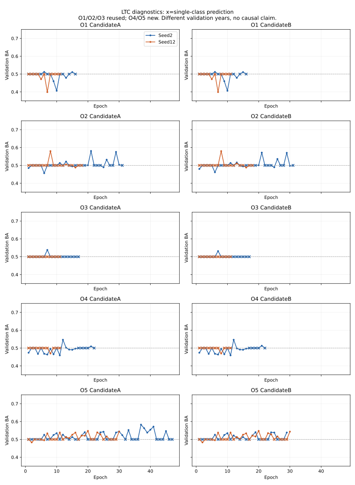

# STEP4A-2 LTC 다섯 Origin 진단

STEP3C 동결 사양에 따른 회고적·탐색적 CPU Train/Validation Pilot이다. A/B=BOTH_UNVERIFIED, 18:00 KST production-PIT=BLOCKED를 유지한다. Validation으로 가격·모델·Seed·사양을 고르지 않았다. O4의 독립 Test2024, O5의 독립 Test2025 예측/평가, 2026 관측, HMM fit, GPU, 외부피처/RAW5/앙상블, τ 실측, 확증 p값은 사용/실행하지 않았다. master training_enabled=false/hmm_fit_enabled=false/new_fit_execution_enabled=false는 보존했다.

원본2피처 LTC 구조·offset401·fixed hyperparameter를 유지했다. 아래20개 LTC identity는 기존 O1/O2/O3의12개와 신규 O4/O5의8개다. 최적 예측이 단일 클래스인 경우도 그대로 표시한다.

| source_stage | origin | candidate | seed | status | train_samples | validation_samples | epochs | best_epoch | validation_BA | macro_f1 | prediction_positive_rate | prediction_status | degenerate_prediction_epochs | degenerate_epoch_ratio |
| --- | --- | --- | --- | --- | --- | --- | --- | --- | --- | --- | --- | --- | --- | --- |
| STEP3A_REUSED | O1 | A | 2 | COMPLETED | 2387 | 228 | 16 | 6 | 0.511935 | 0.485714 | 0.473684 | TWO_CLASS_PREDICTION | 11 | 0.687500 |
| STEP3A_REUSED | O1 | B | 2 | COMPLETED | 2387 | 228 | 16 | 6 | 0.511935 | 0.485714 | 0.473684 | TWO_CLASS_PREDICTION | 11 | 0.687500 |
| STEP3B_NEW | O1 | A | 12 | COMPLETED | 2387 | 228 | 11 | 1 | 0.500000 | 0.409326 | 1.000000 | DEGENERATE_PREDICTION | 9 | 0.818182 |
| STEP3B_NEW | O1 | B | 12 | COMPLETED | 2387 | 228 | 11 | 1 | 0.500000 | 0.409326 | 1.000000 | DEGENERATE_PREDICTION | 9 | 0.818182 |
| STEP3B_NEW | O2 | A | 2 | COMPLETED | 2635 | 228 | 31 | 21 | 0.580664 | 0.565714 | 0.587719 | TWO_CLASS_PREDICTION | 20 | 0.645161 |
| STEP3B_NEW | O2 | B | 2 | COMPLETED | 2635 | 228 | 31 | 21 | 0.571693 | 0.556941 | 0.587719 | TWO_CLASS_PREDICTION | 20 | 0.645161 |
| STEP3B_NEW | O2 | A | 12 | COMPLETED | 2635 | 228 | 18 | 8 | 0.579917 | 0.548427 | 0.671053 | TWO_CLASS_PREDICTION | 15 | 0.833333 |
| STEP3B_NEW | O2 | B | 12 | COMPLETED | 2635 | 228 | 18 | 8 | 0.579917 | 0.548427 | 0.671053 | TWO_CLASS_PREDICTION | 15 | 0.833333 |
| STEP4A1_NEW | O3 | A | 2 | COMPLETED | 2883 | 226 | 17 | 7 | 0.538046 | 0.524941 | 0.482301 | TWO_CLASS_PREDICTION | 16 | 0.941176 |
| STEP4A1_NEW | O3 | B | 2 | COMPLETED | 2883 | 226 | 17 | 7 | 0.531552 | 0.519587 | 0.477876 | TWO_CLASS_PREDICTION | 16 | 0.941176 |
| STEP4A1_NEW | O3 | A | 12 | COMPLETED | 2883 | 226 | 11 | 1 | 0.500000 | 0.254125 | 1.000000 | DEGENERATE_PREDICTION | 11 | 1.000000 |
| STEP4A1_NEW | O3 | B | 12 | COMPLETED | 2883 | 226 | 11 | 1 | 0.500000 | 0.254125 | 1.000000 | DEGENERATE_PREDICTION | 11 | 1.000000 |
| STEP4A2_NEW | O4 | A | 2 | COMPLETED | 3129 | 225 | 22 | 12 | 0.546554 | 0.545785 | 0.560000 | TWO_CLASS_PREDICTION | 9 | 0.409091 |
| STEP4A2_NEW | O4 | B | 2 | COMPLETED | 3129 | 225 | 22 | 12 | 0.546554 | 0.545785 | 0.560000 | TWO_CLASS_PREDICTION | 9 | 0.409091 |
| STEP4A2_NEW | O4 | A | 12 | COMPLETED | 3129 | 225 | 11 | 1 | 0.500000 | 0.369748 | 1.000000 | DEGENERATE_PREDICTION | 10 | 0.909091 |
| STEP4A2_NEW | O4 | B | 12 | COMPLETED | 3129 | 225 | 11 | 1 | 0.500000 | 0.369748 | 1.000000 | DEGENERATE_PREDICTION | 10 | 0.909091 |
| STEP4A2_NEW | O5 | A | 2 | COMPLETED | 3374 | 224 | 47 | 37 | 0.582695 | 0.571203 | 0.312500 | TWO_CLASS_PREDICTION | 25 | 0.531915 |
| STEP4A2_NEW | O5 | B | 2 | COMPLETED | 3374 | 224 | 29 | 19 | 0.540390 | 0.503452 | 0.754464 | TWO_CLASS_PREDICTION | 16 | 0.551724 |
| STEP4A2_NEW | O5 | A | 12 | COMPLETED | 3374 | 224 | 30 | 20 | 0.547573 | 0.485467 | 0.830357 | TWO_CLASS_PREDICTION | 14 | 0.466667 |
| STEP4A2_NEW | O5 | B | 12 | COMPLETED | 3374 | 224 | 30 | 20 | 0.547573 | 0.485467 | 0.830357 | TWO_CLASS_PREDICTION | 14 | 0.466667 |

O1 Seed12의 A/B는 best1/종료11, O2 Seed12는 best8/종료18, O3 Seed12는 best1/종료11이었다. O3 Seed2는16/17epoch(94.1%), Seed12는11/11epoch(100%) 단일 클래스 예측이었다. 이를 수정하거나 제외하지 않고 O4/O5와 비교한다. O4/O5에서 새로 관찰한 단일 클래스 예측·조기 종료·최적epoch·A/B 차이는 위 표 및 신규 epoch history에 있다. 종료 상태 COMPLETED가 안정적 학습이나 양호한 예측을 뜻하지는 않는다.

신규 LTC에서 best checkpoint가 단일 클래스인 경우는 2개다. Seed2/12 차이는 [Seed 진단](STEP4A2_SEED_STABILITY_KO.md)에 평균/표본표준편차와 함께 기록했다. 표준편차는 두 Seed의 탐색적 수치이고 최종 안정성 근거가 아니다. 클래스별 support·학습기간이 다른 Origin 차이를 시장의 인과적 레짐 효과로 표현하지 않는다. 불안정 사례를 다른 Seed나 수정된 loss로 대체하지 않았다. τ actual forward 추출은 실행하지 않았다.
