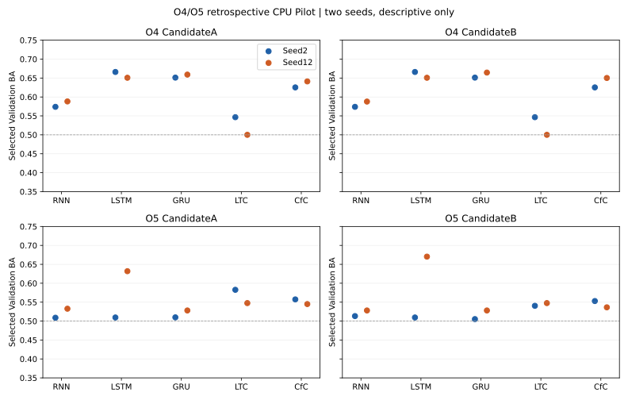

# STEP4A-2 O4/O5 확장 Pilot 결과

확인시각(KST): 2026-11-17T00:27:34.326038+09:00

STEP3C 동결 사양에 따른 회고적·탐색적 CPU Train/Validation Pilot이다. A/B=BOTH_UNVERIFIED, 18:00 KST production-PIT=BLOCKED를 유지한다. Validation으로 가격·모델·Seed·사양을 고르지 않았다. O4의 독립 Test2024, O5의 독립 Test2025 예측/평가, 2026 관측, HMM fit, GPU, 외부피처/RAW5/앙상블, τ 실측, 확증 p값은 사용/실행하지 않았다. master training_enabled=false/hmm_fit_enabled=false/new_fit_execution_enabled=false는 보존했다.

승인된 신규40개 중 완료40, 실패0, BLOCKED0, 중단미완료0이다. 기존60개는 재학습하지 않았고 실제 누적 완료는100개다. 신규757epoch/38793optimizer updates를 기록했다. 누적100개 진단표에는 실패 여부와 source_stage를 포함하며 실제 완료 수와 계획 행 수를 구분한다.

## 데이터·클래스 구성

| origin | candidate | stage | train_dates | train_n | train_0/1 | validation_dates | validation_n | validation_0/1 |
| --- | --- | --- | --- | --- | --- | --- | --- | --- |
| O1 | A | OLD60_REUSED | 2010-03-30~2019-11-29 | 2387 | 1071/1316 | 2020-01-02~2020-12-01 | 228 | 70/158 |
| O1 | B | OLD60_REUSED | 2010-03-30~2019-11-29 | 2387 | 1071/1316 | 2020-01-02~2020-12-01 | 228 | 70/158 |
| O2 | A | OLD60_REUSED | 2010-03-30~2020-12-01 | 2635 | 1145/1490 | 2021-01-04~2021-12-02 | 228 | 131/97 |
| O2 | B | OLD60_REUSED | 2010-03-30~2020-12-01 | 2635 | 1145/1490 | 2021-01-04~2021-12-02 | 228 | 131/97 |
| O3 | A | OLD60_REUSED | 2010-03-30~2021-12-02 | 2883 | 1276/1607 | 2022-01-03~2022-12-01 | 226 | 149/77 |
| O3 | B | OLD60_REUSED | 2010-03-30~2021-12-02 | 2883 | 1276/1607 | 2022-01-03~2022-12-01 | 226 | 149/77 |
| O4 | A | STEP4A2_NEW | 2010-03-30~2022-12-01 | 3129 | 1443/1686 | 2023-01-02~2023-11-29 | 225 | 93/132 |
| O4 | B | STEP4A2_NEW | 2010-03-30~2022-12-01 | 3129 | 1443/1686 | 2023-01-02~2023-11-29 | 225 | 93/132 |
| O5 | A | STEP4A2_NEW | 2010-03-30~2023-11-29 | 3374 | 1544/1830 | 2024-01-02~2024-11-29 | 224 | 116/108 |
| O5 | B | STEP4A2_NEW | 2010-03-30~2023-11-29 | 3374 | 1544/1830 | 2024-01-02~2024-11-29 | 224 | 116/108 |

O4는 Train2010~2022/Validation2023, O5는 Train2010~2023/Validation2024다. 예상3129/225 및3374/224를 맞추기 위해 날짜를 변경하지 않았으며 공식 KRX session_id·20세션 label_end·공통 유한 window 마스크로 재구성해 master 배열/날짜/scaler와 일치함을 확인했다. 각 Train20세션 purge, Validation말단20UNKNOWN 제외, 입력t-19~t와 F1=[Log_Ret,Disparity]를 유지했다. Vol_Regime은 입력이 아니라 공통 적격 마스크 및 수동 레짐 보조 변수다. Scaler는 유지된 Train window 날짜 합집합에만 fit하고 Validation은 transform만 했다. bfill/미래 보간/NaN 자동0 치환은 없다.

## O4/O5 모델별 실제 결과

| origin | candidate | seed | model | status | epochs | best_epoch | validation_BA | macro_f1 | recall0 | recall1 | accuracy | brier | prediction_positive_rate | degenerate_epoch_ratio | postfit_checkpoint_audit_status |
| --- | --- | --- | --- | --- | --- | --- | --- | --- | --- | --- | --- | --- | --- | --- | --- |
| O4 | A | 2 | RNN | COMPLETED | 16 | 6 | 0.573925 | 0.571942 | 0.397849 | 0.750000 | 0.604444 | 0.245468 | 0.688889 | 0.187500 | PASS |
| O4 | A | 2 | LSTM | COMPLETED | 20 | 10 | 0.666056 | 0.659254 | 0.688172 | 0.643939 | 0.662222 | 0.238432 | 0.506667 | 0.050000 | PASS |
| O4 | A | 2 | GRU | COMPLETED | 12 | 2 | 0.651149 | 0.649781 | 0.612903 | 0.689394 | 0.657778 | 0.247298 | 0.564444 | 0.083333 | PASS |
| O4 | A | 2 | LTC | COMPLETED | 22 | 12 | 0.546554 | 0.545785 | 0.494624 | 0.598485 | 0.555556 | 0.250003 | 0.560000 | 0.409091 | PASS |
| O4 | A | 2 | CfC | COMPLETED | 12 | 2 | 0.625244 | 0.623495 | 0.591398 | 0.659091 | 0.631111 | 0.241619 | 0.555556 | 0.000000 | PASS |
| O4 | B | 2 | RNN | COMPLETED | 16 | 6 | 0.573925 | 0.571942 | 0.397849 | 0.750000 | 0.604444 | 0.245467 | 0.688889 | 0.187500 | PASS |
| O4 | B | 2 | LSTM | COMPLETED | 20 | 10 | 0.666056 | 0.659254 | 0.688172 | 0.643939 | 0.662222 | 0.238438 | 0.506667 | 0.050000 | PASS |
| O4 | B | 2 | GRU | COMPLETED | 12 | 2 | 0.651149 | 0.649781 | 0.612903 | 0.689394 | 0.657778 | 0.247297 | 0.564444 | 0.083333 | PASS |
| O4 | B | 2 | LTC | COMPLETED | 22 | 12 | 0.546554 | 0.545785 | 0.494624 | 0.598485 | 0.555556 | 0.249993 | 0.560000 | 0.409091 | PASS |
| O4 | B | 2 | CfC | COMPLETED | 12 | 2 | 0.625244 | 0.623495 | 0.591398 | 0.659091 | 0.631111 | 0.241617 | 0.555556 | 0.000000 | PASS |
| O4 | A | 12 | RNN | COMPLETED | 15 | 5 | 0.588221 | 0.588716 | 0.494624 | 0.681818 | 0.604444 | 0.245465 | 0.608889 | 0.066667 | PASS |
| O4 | A | 12 | LSTM | COMPLETED | 17 | 7 | 0.650782 | 0.652126 | 0.559140 | 0.742424 | 0.666667 | 0.247439 | 0.617778 | 0.117647 | PASS |
| O4 | A | 12 | GRU | COMPLETED | 13 | 3 | 0.659091 | 0.653839 | 0.666667 | 0.651515 | 0.657778 | 0.247568 | 0.520000 | 0.153846 | PASS |
| O4 | A | 12 | LTC | COMPLETED | 11 | 1 | 0.500000 | 0.369748 | 0.000000 | 1.000000 | 0.586667 | 0.245460 | 1.000000 | 0.909091 | PASS |
| O4 | A | 12 | CfC | COMPLETED | 25 | 15 | 0.641129 | 0.630059 | 0.698925 | 0.583333 | 0.631111 | 0.238226 | 0.466667 | 0.240000 | PASS |
| O4 | B | 12 | RNN | COMPLETED | 20 | 10 | 0.587854 | 0.587799 | 0.440860 | 0.734848 | 0.613333 | 0.248103 | 0.662222 | 0.050000 | PASS |
| O4 | B | 12 | LSTM | COMPLETED | 17 | 7 | 0.650782 | 0.652126 | 0.559140 | 0.742424 | 0.666667 | 0.247436 | 0.617778 | 0.117647 | PASS |
| O4 | B | 12 | GRU | COMPLETED | 13 | 3 | 0.664467 | 0.658655 | 0.677419 | 0.651515 | 0.662222 | 0.247566 | 0.515556 | 0.153846 | PASS |
| O4 | B | 12 | LTC | COMPLETED | 11 | 1 | 0.500000 | 0.369748 | 0.000000 | 1.000000 | 0.586667 | 0.245460 | 1.000000 | 0.909091 | PASS |
| O4 | B | 12 | CfC | COMPLETED | 26 | 16 | 0.650171 | 0.650621 | 0.580645 | 0.719697 | 0.662222 | 0.232178 | 0.595556 | 0.115385 | PASS |
| O5 | A | 2 | RNN | COMPLETED | 11 | 1 | 0.508940 | 0.508772 | 0.508621 | 0.509259 | 0.508929 | 0.248910 | 0.500000 | 0.000000 | PASS |
| O5 | A | 2 | LSTM | COMPLETED | 11 | 1 | 0.509579 | 0.466667 | 0.241379 | 0.777778 | 0.500000 | 0.250738 | 0.767857 | 0.000000 | PASS |
| O5 | A | 2 | GRU | COMPLETED | 16 | 6 | 0.509898 | 0.464069 | 0.232759 | 0.787037 | 0.500000 | 0.252799 | 0.776786 | 0.125000 | PASS |
| O5 | A | 2 | LTC | COMPLETED | 47 | 37 | 0.582695 | 0.571203 | 0.767241 | 0.398148 | 0.589286 | 0.247282 | 0.312500 | 0.531915 | PASS |
| O5 | A | 2 | CfC | COMPLETED | 17 | 7 | 0.557312 | 0.557321 | 0.577586 | 0.537037 | 0.558036 | 0.246812 | 0.477679 | 0.000000 | PASS |
| O5 | B | 2 | RNN | COMPLETED | 11 | 1 | 0.513250 | 0.513150 | 0.517241 | 0.509259 | 0.513393 | 0.248908 | 0.495536 | 0.000000 | PASS |
| O5 | B | 2 | LSTM | COMPLETED | 11 | 1 | 0.509579 | 0.466667 | 0.241379 | 0.777778 | 0.500000 | 0.250738 | 0.767857 | 0.000000 | PASS |
| O5 | B | 2 | GRU | COMPLETED | 16 | 6 | 0.505268 | 0.460609 | 0.232759 | 0.777778 | 0.495536 | 0.252793 | 0.772321 | 0.125000 | PASS |
| O5 | B | 2 | LTC | COMPLETED | 29 | 19 | 0.540390 | 0.503452 | 0.284483 | 0.796296 | 0.531250 | 0.249357 | 0.754464 | 0.551724 | PASS |
| O5 | B | 2 | CfC | COMPLETED | 17 | 7 | 0.553001 | 0.553001 | 0.568966 | 0.537037 | 0.553571 | 0.246834 | 0.482143 | 0.000000 | PASS |
| O5 | A | 12 | RNN | COMPLETED | 23 | 13 | 0.532727 | 0.531016 | 0.491379 | 0.574074 | 0.531250 | 0.249712 | 0.540179 | 0.086957 | PASS |
| O5 | A | 12 | LSTM | COMPLETED | 30 | 20 | 0.631865 | 0.613888 | 0.439655 | 0.824074 | 0.625000 | 0.243656 | 0.687500 | 0.033333 | PASS |
| O5 | A | 12 | GRU | COMPLETED | 11 | 1 | 0.528097 | 0.480591 | 0.241379 | 0.814815 | 0.517857 | 0.252228 | 0.785714 | 0.181818 | PASS |
| O5 | A | 12 | LTC | COMPLETED | 30 | 20 | 0.547573 | 0.485467 | 0.215517 | 0.879630 | 0.535714 | 0.249461 | 0.830357 | 0.466667 | PASS |
| O5 | A | 12 | CfC | COMPLETED | 18 | 8 | 0.545019 | 0.544607 | 0.534483 | 0.555556 | 0.544643 | 0.247587 | 0.508929 | 0.000000 | PASS |
| O5 | B | 12 | RNN | COMPLETED | 23 | 13 | 0.528097 | 0.526635 | 0.491379 | 0.564815 | 0.526786 | 0.249709 | 0.535714 | 0.086957 | PASS |
| O5 | B | 12 | LSTM | COMPLETED | 45 | 35 | 0.670338 | 0.668552 | 0.775862 | 0.564815 | 0.674107 | 0.214681 | 0.388393 | 0.022222 | PASS |
| O5 | B | 12 | GRU | COMPLETED | 11 | 1 | 0.528097 | 0.480591 | 0.241379 | 0.814815 | 0.517857 | 0.252230 | 0.785714 | 0.181818 | PASS |
| O5 | B | 12 | LTC | COMPLETED | 30 | 20 | 0.547573 | 0.485467 | 0.215517 | 0.879630 | 0.535714 | 0.249472 | 0.830357 | 0.466667 | PASS |
| O5 | B | 12 | CfC | COMPLETED | 18 | 8 | 0.536398 | 0.535714 | 0.517241 | 0.555556 | 0.535714 | 0.247652 | 0.517857 | 0.000000 | PASS |

각 identity의 effective_seed, config/source/environment/data/scaler/feature-order SHA, best/latest checkpoint SHA와 lineage sidecar SHA는 [runs](../manifests/step4a2_runs.csv)에 있다. 모든 epoch의 Train/Val loss·BA·MacroF1·Recall0/1·Brier·positive rate·단일 클래스 예측·running best epoch는 [epoch history](../manifests/step4a2_epoch_history.csv)에 보존했다. EarlyStopping과 best checkpoint 선택은 strict Validation BA 개선만 사용했고 동률은 최초 최고 epoch를 유지했다.

## A/B 민감도

| origin | seed | model | completed_candidates | validation_BA_A | validation_BA_B | validation_BA_delta_B_minus_A | macro_f1_A | macro_f1_B | best_epoch_A | best_epoch_B |
| --- | --- | --- | --- | --- | --- | --- | --- | --- | --- | --- |
| O4 | 2 | RNN | 2 | 0.573925 | 0.573925 | 0.000000 | 0.571942 | 0.571942 | 6.000000 | 6.000000 |
| O4 | 2 | LSTM | 2 | 0.666056 | 0.666056 | 0.000000 | 0.659254 | 0.659254 | 10.000000 | 10.000000 |
| O4 | 2 | GRU | 2 | 0.651149 | 0.651149 | 0.000000 | 0.649781 | 0.649781 | 2.000000 | 2.000000 |
| O4 | 2 | LTC | 2 | 0.546554 | 0.546554 | 0.000000 | 0.545785 | 0.545785 | 12.000000 | 12.000000 |
| O4 | 2 | CfC | 2 | 0.625244 | 0.625244 | 0.000000 | 0.623495 | 0.623495 | 2.000000 | 2.000000 |
| O4 | 12 | RNN | 2 | 0.588221 | 0.587854 | -0.000367 | 0.588716 | 0.587799 | 5.000000 | 10.000000 |
| O4 | 12 | LSTM | 2 | 0.650782 | 0.650782 | 0.000000 | 0.652126 | 0.652126 | 7.000000 | 7.000000 |
| O4 | 12 | GRU | 2 | 0.659091 | 0.664467 | 0.005376 | 0.653839 | 0.658655 | 3.000000 | 3.000000 |
| O4 | 12 | LTC | 2 | 0.500000 | 0.500000 | 0.000000 | 0.369748 | 0.369748 | 1.000000 | 1.000000 |
| O4 | 12 | CfC | 2 | 0.641129 | 0.650171 | 0.009042 | 0.630059 | 0.650621 | 15.000000 | 16.000000 |
| O5 | 2 | RNN | 2 | 0.508940 | 0.513250 | 0.004310 | 0.508772 | 0.513150 | 1.000000 | 1.000000 |
| O5 | 2 | LSTM | 2 | 0.509579 | 0.509579 | 0.000000 | 0.466667 | 0.466667 | 1.000000 | 1.000000 |
| O5 | 2 | GRU | 2 | 0.509898 | 0.505268 | -0.004630 | 0.464069 | 0.460609 | 6.000000 | 6.000000 |
| O5 | 2 | LTC | 2 | 0.582695 | 0.540390 | -0.042305 | 0.571203 | 0.503452 | 37.000000 | 19.000000 |
| O5 | 2 | CfC | 2 | 0.557312 | 0.553001 | -0.004310 | 0.557321 | 0.553001 | 7.000000 | 7.000000 |
| O5 | 12 | RNN | 2 | 0.532727 | 0.528097 | -0.004630 | 0.531016 | 0.526635 | 13.000000 | 13.000000 |
| O5 | 12 | LSTM | 2 | 0.631865 | 0.670338 | 0.038474 | 0.613888 | 0.668552 | 20.000000 | 35.000000 |
| O5 | 12 | GRU | 2 | 0.528097 | 0.528097 | 0.000000 | 0.480591 | 0.480591 | 1.000000 | 1.000000 |
| O5 | 12 | LTC | 2 | 0.547573 | 0.547573 | 0.000000 | 0.485467 | 0.485467 | 20.000000 | 20.000000 |
| O5 | 12 | CfC | 2 | 0.545019 | 0.536398 | -0.008621 | 0.544607 | 0.535714 | 8.000000 | 8.000000 |

A/B 피처·scaler를 독립 계산했다. 양쪽 공급처/개정정책/역사적 공개시각은 여전히 미확정이다. 위 수치로 주 가격을 선택하지 않았다. Validation은 checkpoint 선택에 쓰인 데이터이므로 독립 일반화 성능으로 쓰지 않는다.

## CfC의 다른 검증 연도 진단

| source_stage | origin | candidate | seed | epochs | best_epoch | validation_BA | macro_f1 | prediction_positive_rate | degenerate_epoch_ratio |
| --- | --- | --- | --- | --- | --- | --- | --- | --- | --- |
| STEP3A_REUSED | O1 | A | 2 | 16 | 6 | 0.575045 | 0.573718 | 0.675439 | 0.000000 |
| STEP3A_REUSED | O1 | B | 2 | 16 | 6 | 0.575045 | 0.573718 | 0.675439 | 0.000000 |
| STEP3B_NEW | O1 | A | 12 | 25 | 15 | 0.574503 | 0.550242 | 0.517544 | 0.080000 |
| STEP3B_NEW | O1 | B | 12 | 16 | 6 | 0.542586 | 0.539594 | 0.644737 | 0.000000 |
| STEP3B_NEW | O2 | A | 2 | 12 | 2 | 0.541591 | 0.425128 | 0.890351 | 0.000000 |
| STEP3B_NEW | O2 | B | 2 | 12 | 2 | 0.541591 | 0.425128 | 0.890351 | 0.000000 |
| STEP3B_NEW | O2 | A | 12 | 19 | 9 | 0.538916 | 0.431926 | 0.872807 | 0.157895 |
| STEP3B_NEW | O2 | B | 12 | 19 | 9 | 0.538916 | 0.431926 | 0.872807 | 0.105263 |
| STEP4A1_NEW | O3 | A | 2 | 20 | 10 | 0.605116 | 0.490412 | 0.796460 | 0.000000 |
| STEP4A1_NEW | O3 | B | 2 | 41 | 31 | 0.654493 | 0.608658 | 0.588496 | 0.121951 |
| STEP4A1_NEW | O3 | A | 12 | 19 | 9 | 0.729060 | 0.659232 | 0.646018 | 0.157895 |
| STEP4A1_NEW | O3 | B | 12 | 19 | 9 | 0.691711 | 0.600236 | 0.721239 | 0.052632 |
| STEP4A2_NEW | O4 | A | 2 | 12 | 2 | 0.625244 | 0.623495 | 0.555556 | 0.000000 |
| STEP4A2_NEW | O4 | B | 2 | 12 | 2 | 0.625244 | 0.623495 | 0.555556 | 0.000000 |
| STEP4A2_NEW | O4 | A | 12 | 25 | 15 | 0.641129 | 0.630059 | 0.466667 | 0.240000 |
| STEP4A2_NEW | O4 | B | 12 | 26 | 16 | 0.650171 | 0.650621 | 0.595556 | 0.115385 |
| STEP4A2_NEW | O5 | A | 2 | 17 | 7 | 0.557312 | 0.557321 | 0.477679 | 0.000000 |
| STEP4A2_NEW | O5 | B | 2 | 17 | 7 | 0.553001 | 0.553001 | 0.482143 | 0.000000 |
| STEP4A2_NEW | O5 | A | 12 | 18 | 8 | 0.545019 | 0.544607 | 0.508929 | 0.000000 |
| STEP4A2_NEW | O5 | B | 12 | 18 | 8 | 0.536398 | 0.535714 | 0.517857 | 0.000000 |

O3의 높은 일부 CfC Validation BA와 O4/O5의 결과를 모두 보존한다. 이번 CfC의 O4 BA는0.625244~0.650171, O5는0.536398~0.557312 범위였다. O3 Seed12/A의0.729060이 모든 검증연도에서 같은 수준으로 관찰된 것은 아니다. 이 수치로 CfC나 가격 후보를 사후 선택하지 않았다. 서로 다른 검증연도·학습기간·클래스 구성이 함께 달라지므로 인과적 레짐 효과나 미관측 Test 성능의 재현으로 단정하지 않는다. 유리한 연도/Seed/가격을 선택하지 않는다. 모든5모델의 [누적100개 진단표](../manifests/step4a2_all100_diagnostic_metrics.csv)는 기존60개와 신규40개를 구분한다.

[실행 감사](STEP4A2_EXECUTION_AUDIT_KO.md), [LTC5Origin](STEP4A2_LTC_FIVE_ORIGIN_KO.md), [Seed](STEP4A2_SEED_STABILITY_KO.md), [수동 레짐](STEP4A2_MANUAL_REGIME_KO.md), [다음 gate](STEP4A2_NEXT_GATES_KO.md).
